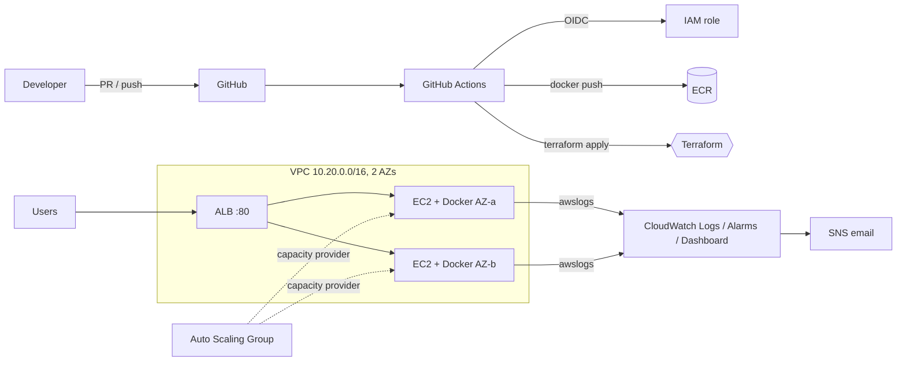

# ECS on EC2 Platform: Dockerised Service on AWS with GitHub Actions

A containerised Flask service running on **Amazon ECS (EC2 launch type)**: Docker containers on an Auto Scaling Group of ECS-optimised instances, behind an **Application Load Balancer**. Infrastructure is **Terraform**; delivery is **GitHub Actions** authenticating to AWS with **OIDC** (no stored AWS keys). Monitoring uses **CloudWatch**.

Diagram: [`docs/architecture.svg`](docs/architecture.svg)

## 1. Architecture



| Layer | Implementation |
|---|---|
| Network | VPC, 2 public subnets (ALB, NAT), 2 private subnets (container hosts), 2 AZs |
| Compute | ECS cluster on an **ASG** of ECS-optimised Amazon Linux 2023 instances (`t3.small`), joined via an **ECS capacity provider** with managed scaling |
| Containers | Docker, `bridge` network mode with **dynamic host ports**; multiple tasks can share a host |
| Ingress | ALB → target group (`instance` type, `/health`) → dynamic host ports. Instance SG allows ephemeral ports **only from the ALB SG** |
| Scaling | Tasks: CPU target-tracking (2 to 6). Hosts: capacity provider scales the ASG (2 to 4) to fit pending tasks |
| Registry | ECR: immutable tags (git SHA), scan-on-push, lifecycle policy |
| Observability | JSON logs → CloudWatch, Container Insights, 6 alarms, dashboard, SNS |
| State | S3 (versioned, encrypted) + DynamoDB lock |

## 2. Layout

```
app/                       Flask app, tests, multi-stage Dockerfile (base / test / runtime)
terraform/bootstrap/       One-off: S3+DynamoDB state backend, GitHub OIDC provider + deploy role
terraform/modules/         network · ecr · alb · ecs (EC2/ASG/capacity provider) · monitoring
terraform/envs/prod/       Composition root
.github/workflows/ci-cd.yml  CI/CD pipeline
docs/architecture.svg      Diagram
```

## 3. Deployment steps

**Prerequisites:** AWS account + credentials (for the one-off bootstrap only), Terraform ≥ 1.6, a GitHub repo containing this code.

### a) Bootstrap (once, from your laptop)
```bash
cd terraform/bootstrap
terraform init
terraform apply \
  -var state_bucket_name=<globally-unique-name> \
  -var github_repo=<owner>/<repo>
# add -var create_github_oidc_provider=false if the account already has a GitHub OIDC provider
```
Note the outputs `state_bucket` and `github_deploy_role_arn`.

### b) Configure GitHub
Repo → **Settings → Secrets and variables → Actions → Variables**:

| Variable | Value |
|---|---|
| `AWS_ROLE_ARN` | `github_deploy_role_arn` output |
| `TF_STATE_BUCKET` | `state_bucket` output |
| `AWS_REGION` | optional, default `us-east-1` |

Optional: **Settings → Environments → `production`** → add *required reviewers* for a manual approval gate before deploys.

### c) Deploy
Push to `main`. The workflow runs automatically.

| Job | Trigger | What it does |
|---|---|---|
| `test` | PR + push | `docker build --target test` runs pytest inside the image build |
| `validate` | PR + push | `terraform fmt -check`, `init -backend=false`, `validate` |
| `plan` | PR | Plans against real state so reviewers see infra changes (read-only, `-lock=false`) |
| `deploy` | push to `main` / manual | ECR first → build & push `:<git-sha>` → `plan` → `apply` (rolling ECS update) → wait for stability → smoke test `/health` |
| `destroy` | manual (`Run workflow` → `destroy`) | Tears everything down |

### d) Verify
The run summary prints the app URL.
```bash
curl http://<alb-dns>/ ; curl http://<alb-dns>/health
curl http://<alb-dns>/error   # x4: generates ERROR logs → log-metric alarm
```
CloudWatch → Dashboards → `devops-challenge-prod-overview`. Shell access to hosts: SSM Session Manager (no SSH).

### Local run
```bash
cd app && docker build --target runtime -t demo . && docker run -p 8080:8080 demo
```

## 4. Design decisions

- **ECS on EC2 with a capacity provider:** gives control of the Docker host (instance type, AMI, disk) while ECS handles scheduling. Managed scaling grows/shrinks the ASG automatically; managed termination protection stops ECS scaling in hosts that are running tasks.
- **Bridge mode + dynamic ports:** several tasks per host, which allows bin-packing and zero-downtime rolling updates on a small cluster (new and old task versions can coexist on one host). Trade-off: no per-task security group (awsvpc mode would offer that, at the cost of ENI limits per instance).
- **OIDC instead of access keys:** the role trust policy is limited to `repo:<owner>/<repo>:*`; credentials are short-lived and nothing sensitive lives in GitHub.
- **Immutable git-SHA image tags** make every deploy traceable and rollbacks exact; `latest` is never used.
- **Terraform performs the deploy** (new task-definition revision), so infra and app version cannot drift.
- **Safe rollouts:** 100% minimum healthy, 200% maximum, plus the ECS **deployment circuit breaker with rollback**. Rolling `instance_refresh` is used when the launch template (AMI/user-data) changes.
- **Hardening:** hosts in private subnets with no public IPs, IMDSv2 required, encrypted gp3 volumes, SSM instead of SSH, separate instance / execution / task IAM roles, non-root container.
- **Tests inside the Dockerfile:** identical toolchain locally and in CI.
- **Concurrency control:** one infra job at a time (`concurrency` group) plus DynamoDB state locking.

## 5. Assumptions

- Single AWS account and region (`us-east-1`).
- "ECS + Docker" is interpreted as the **EC2 launch type** (Docker on EC2 container instances), not Fargate.
- No domain provided, so the ALB serves **HTTP only**.
- The workload is stateless.
- The GitHub repository is the one named in `github_repo`.

## 6. Limitations & improvements

- **Deploy role is `AdministratorAccess`:** pragmatic for a challenge because Terraform manages VPC, IAM, ECS and more. For production, scope it to the specific services and use a permissions boundary; use a read-only role for `plan`.
- **HTTPS:** add an ACM certificate and a 443 listener with a redirect (needs a domain).
- **NAT:** single NAT gateway to save cost. Use one per AZ or VPC endpoints (ECR, S3, Logs) for AZ-level resilience.
- **Host patching:** AMI is resolved from SSM at apply time; instances roll on the next deploy that changes the launch template. A scheduled workflow could refresh them regularly.
- **Security scanning:** ECR scan-on-push is on; add Trivy and Checkov steps and fail on high severity.
- **Environments:** add `envs/staging` and promote with environment approvals.
- **Cost:** 2× `t3.small` + NAT + ALB run continuously. Use the `destroy` action when finished.
- The Terraform has not been applied to a live account in the authoring environment; run `terraform fmt -recursive` and `validate` before the first push.
